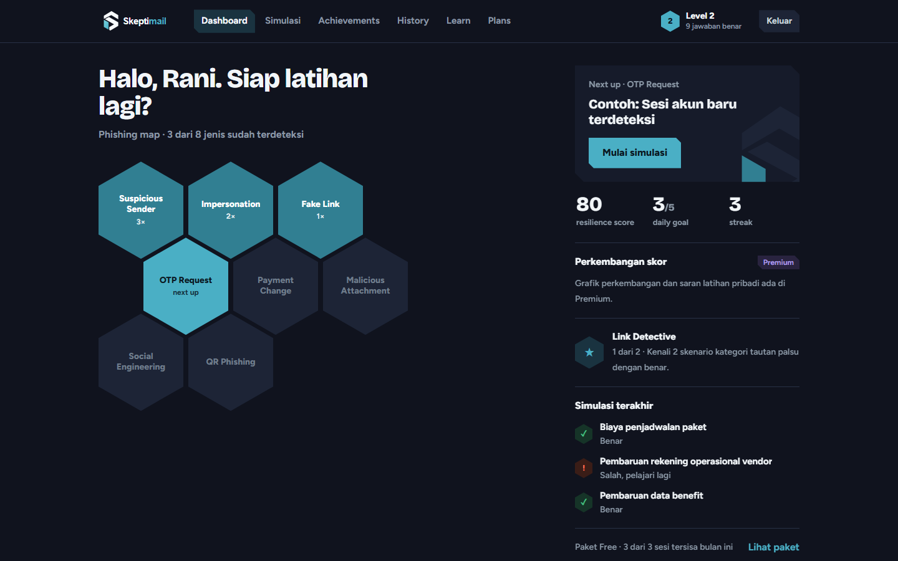
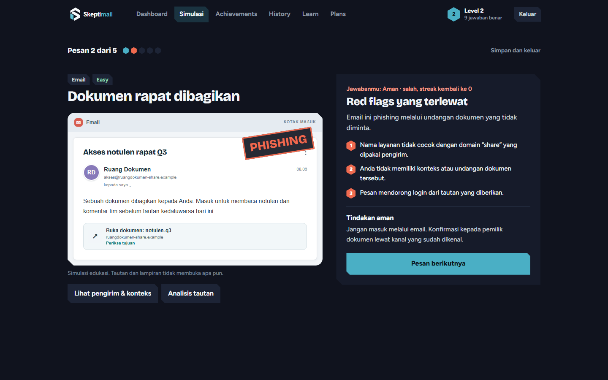
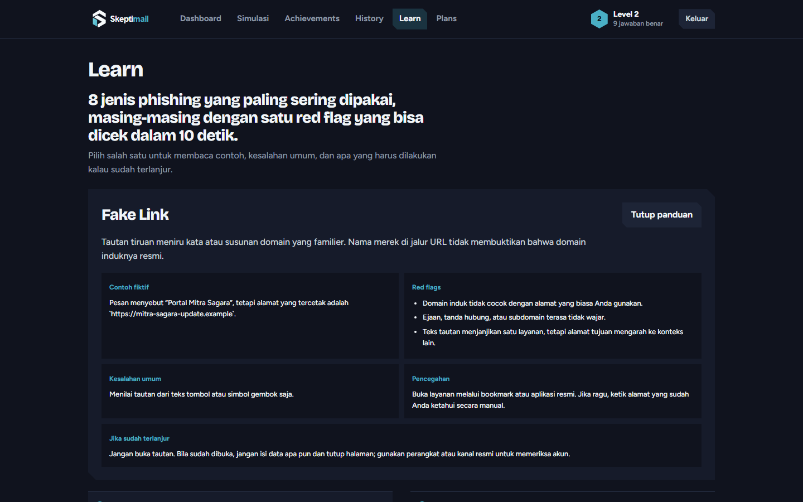
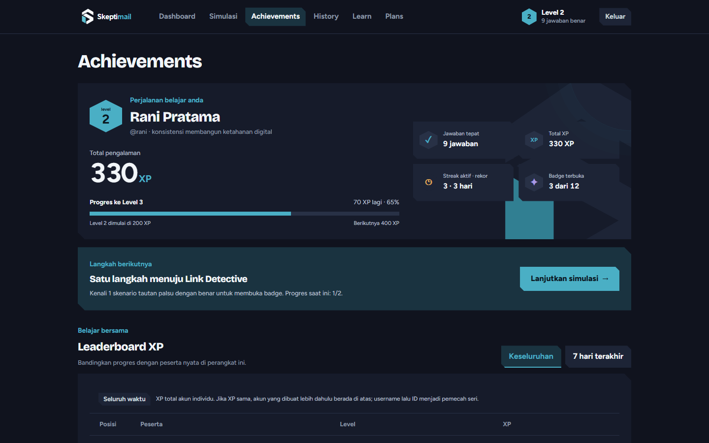
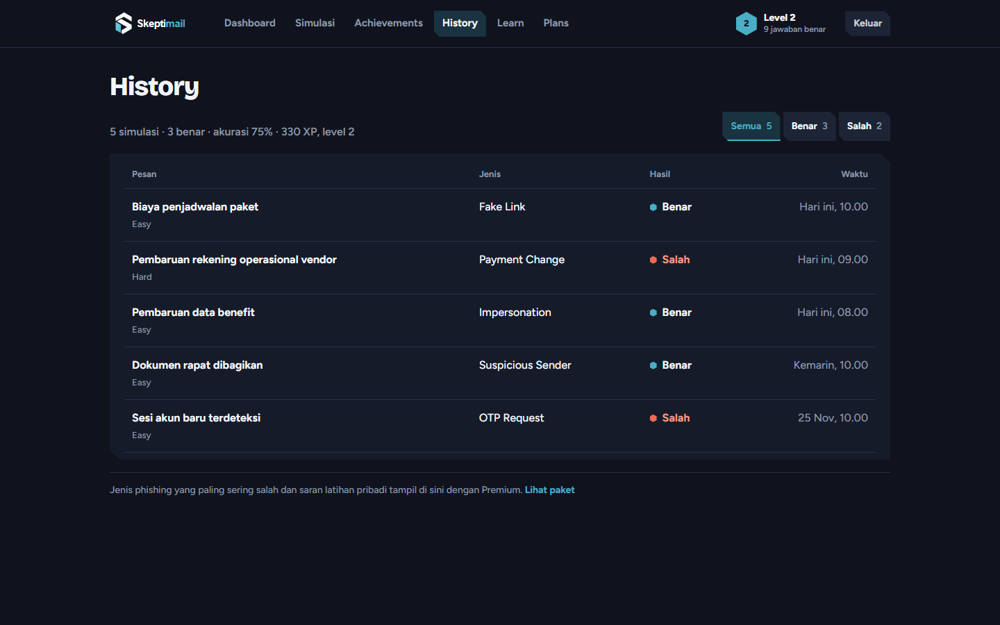
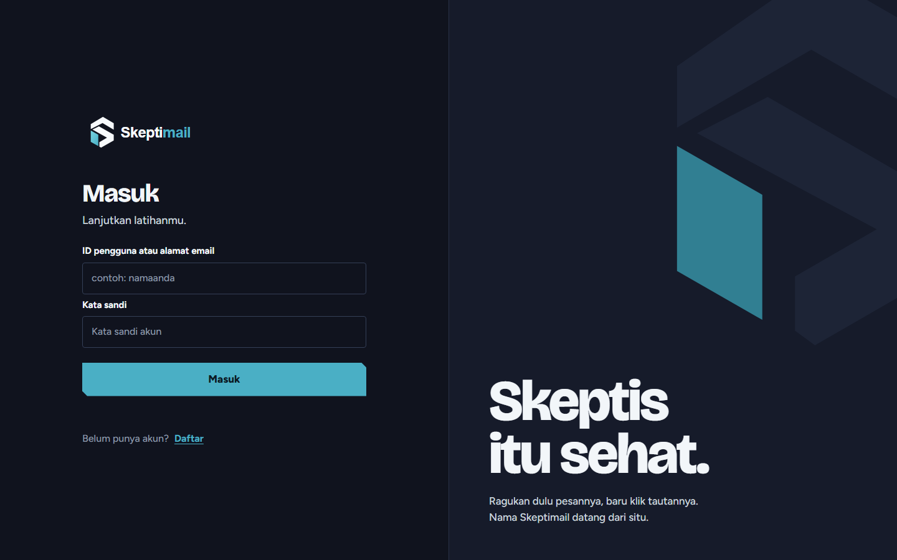
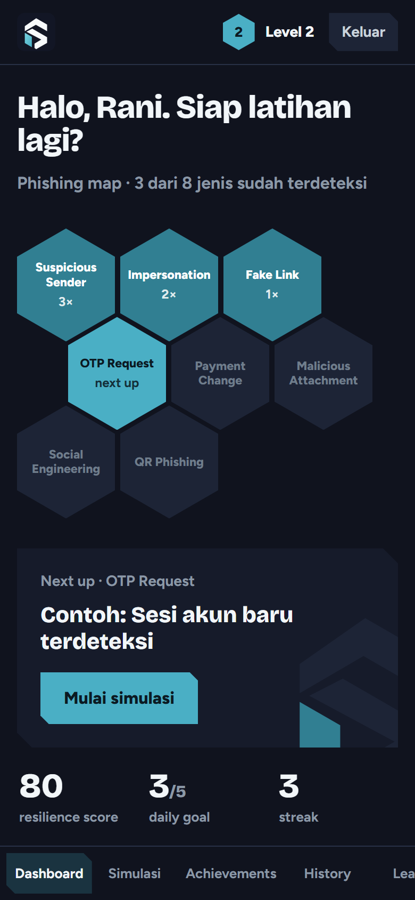
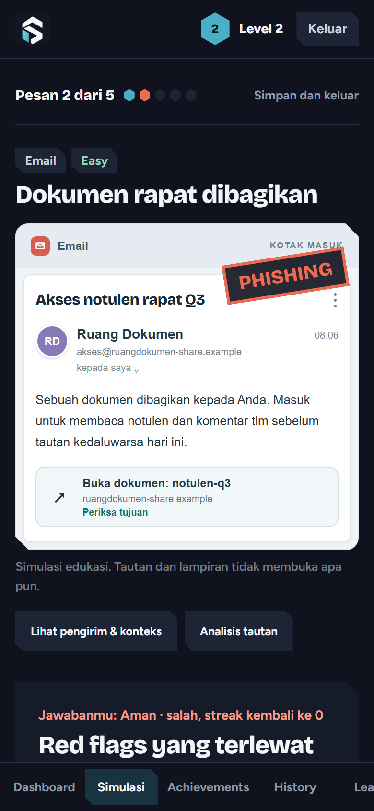
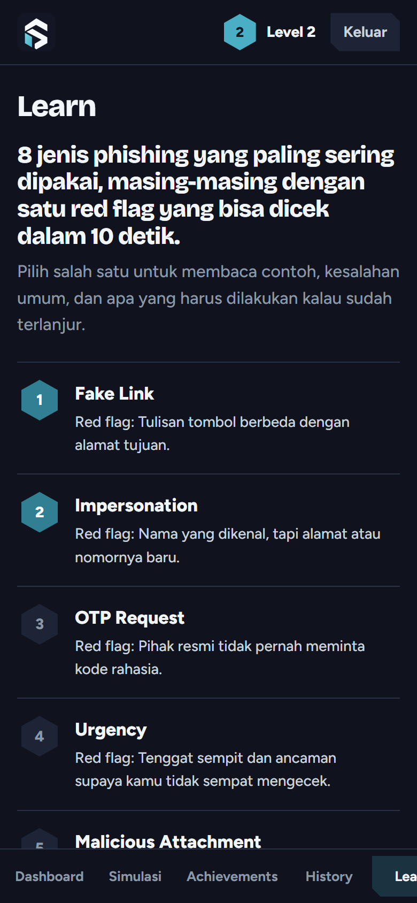

<p align="center">
  
  
</p>

<p align="center">
  <b>Skeptis itu sehat.</b><br>
  Latihan mengenali phishing lewat simulasi pesan fiktif yang aman, satu pesan per layar.
</p>

<p align="center">
  
  
</p>

<p align="center">
  
</p>

## Apa itu Skeptimail?

Skeptimail adalah platform latihan kesadaran keamanan siber. Setiap simulasi menampilkan pesan WhatsApp, email, SMS, notifikasi, halaman web, atau kode QR, dan pengguna menjawab apakah pesan itu aman atau phishing. Setelah menjawab, red flags di pesan itu dibahas satu per satu sehingga pengguna terbiasa memeriksa pesan sebelum bertindak.

Semua contoh di dalamnya fiktif. Tautan dan lampiran di dalam latihan tidak membuka apa pun.

## Fitur

| Bagian | Yang bisa dilakukan |
|---|---|
| Dashboard | Phishing map berisi 8 jenis phishing dalam bentuk sarang lebah. Jenis yang sudah terdeteksi berwarna teal, dan yang berikutnya menyala. |
| Simulasi | Satu pesan per layar dengan alat untuk memeriksa pengirim dan tautan. Setelah menjawab, pesan diberi cap PHISHING atau LEGIT, lalu muncul red flags bernomor dan langkah yang aman. |
| Learn | Daftar jenis phishing dengan satu red flag kunci untuk masing-masing, panduan lengkap, kuis singkat, dan checklist "jeda sebelum merespons". |
| Achievements | Level, XP, streak harian, badge, dan leaderboard. |
| History | Riwayat semua simulasi, bisa disaring benar atau salah. |
| Plans dan perusahaan | Paket Free dan Premium untuk individu, serta dashboard organisasi untuk melatih karyawan. |

## Tampilan

<table>
  <tr>
    <td width="50%"></td>
    <td width="50%"></td>
  </tr>
  <tr>
    <td align="center"><sub>Layar simulasi setelah menjawab, dengan red flags bernomor</sub></td>
    <td align="center"><sub>Panduan Fake Link di halaman Learn</sub></td>
  </tr>
  <tr>
    <td width="50%"></td>
    <td width="50%"></td>
  </tr>
  <tr>
    <td align="center"><sub>Level, XP, dan leaderboard di halaman Achievements</sub></td>
    <td align="center"><sub>Riwayat simulasi di halaman History</sub></td>
  </tr>
  <tr>
    <td colspan="2"></td>
  </tr>
  <tr>
    <td colspan="2" align="center"><sub>Halaman login</sub></td>
  </tr>
</table>

### Di HP

<p align="center">
  
  &nbsp;
  
  &nbsp;
  
</p>

<sub>Screenshot memakai akun contoh fiktif.</sub>

## Menjalankan

Tidak perlu install atau build. Cukup jalankan server statis di folder proyek:

```powershell
python -m http.server 4173 --bind 127.0.0.1
```

Lalu buka [http://localhost:4173](http://localhost:4173).

> Server statis apa pun bisa dipakai, misalnya ekstensi *Live Server* di VS Code.

## Coba dalam 2 menit

1. Klik **Daftar**, buat akun **Individu**, lalu masuk.
2. Di **Dashboard**, klik **Mulai simulasi** dan selesaikan satu sesi berisi 5 pesan.
3. Setelah setiap jawaban, baca cap hasil dan red flags bernomor di bawahnya.
4. Lihat XP, level, dan badge di **Achievements**, lalu riwayatnya di **History**.
5. Buka **Learn** untuk membaca panduan tiap jenis phishing dan mencoba kuis.
6. Daftarkan akun **Perusahaan** untuk melihat dashboard organisasi.

## Struktur proyek

```
├── index.html              halaman utama, memuat semua script berurutan
├── style.css               seluruh tampilan: 3 lapisan (dasar → tema → tata letak halaman)
├── scenarios.js            bank skenario pesan fiktif
├── app.js                  shell aplikasi, navigasi, dan event klik
├── js/
│   ├── utils.js            helper umum, termasuk template html``
│   ├── state.js            state global
│   ├── progress.js         XP, level, streak, badge
│   ├── account-model.js    bentuk data akun
│   ├── storage.js          penyimpanan akun dan progres
│   ├── auth.js             halaman masuk dan daftar
│   ├── subscription.js     Plans: Free, Premium, Company
│   ├── simulation.js       layar simulasi dan pratinjau pesan
│   ├── individual-pages.js Dashboard, Achievements, History
│   ├── education.js        halaman Learn: materi, kuis, checklist
│   └── company.js          dashboard perusahaan
├── assets/                 logo dan ikon
└── docs/screenshots/       gambar untuk README ini
```

Semua file memakai HTML, CSS, dan JavaScript biasa tanpa framework. Script berbagi variabel global, jadi urutan `<script>` di `index.html` penting.
